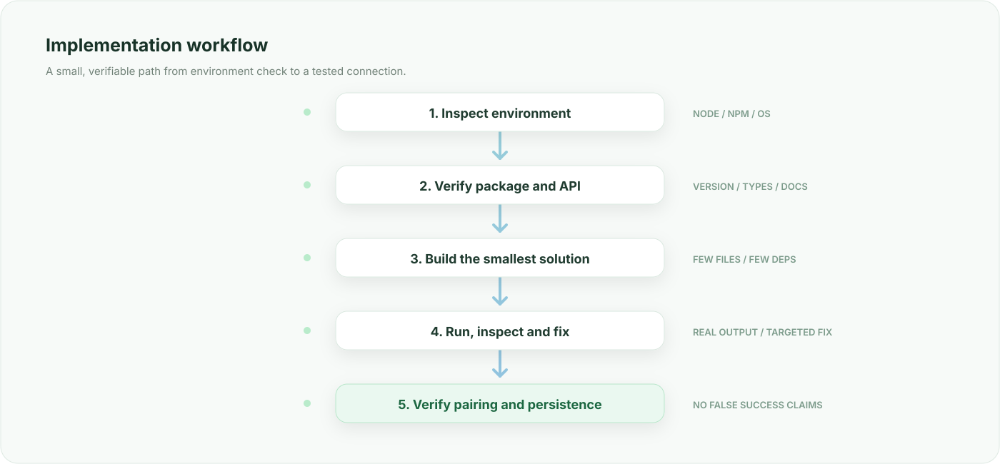

<p align="center">
  
</p>

<p align="center">
  <a href="https://nodejs.org/">
    
  </a>
  <a href="https://baileys.wiki/">
    
  </a>
  <a href="https://github.com/WhiskeySockets/Baileys">
    
  </a>
  
</p>

<h1 align="center">WhatsApp Bot Builder Skill</h1>

<p align="center">
  A practical instruction set for AI assistants that build, debug, and test WhatsApp bots with Node.js and Baileys.
</p>

---

## Overview

**WhatsApp Bot Builder** helps an AI coding assistant work through the complete bot development process: inspect the environment, verify the library API, implement authentication, handle connection events, and test the result.

It is designed around one rule: **build the smallest implementation that can be verified to work.**

The skill discourages outdated snippets, unnecessary abstractions, uncontrolled reconnect loops, lost sessions, and claims of success without test evidence.

## What it covers

| Area | Scope |
| --- | --- |
| Environment | Node.js, npm, operating system, module format |
| Compatibility | Installed package, version, types, breaking changes |
| Authentication | QR login, pairing code, credential persistence |
| Connection | Lifecycle events, disconnect handling, controlled reconnects |
| Messages | Incoming message parsing, command routing, replies |
| Debugging | Read actual terminal output and apply targeted fixes |
| Testing | Startup, pairing flow, message handling, restart persistence |
| Delivery | Run instructions, test results, known limitations |

## Workflow

<p align="center">
  
</p>

1. **Inspect** — check the user's Node.js version, package manager, operating system, and current project.
2. **Verify** — check the exact package, installed version, documentation, and available API types.
3. **Build** — choose a minimal structure and implement only the required features.
4. **Test** — run the project, inspect real output, and fix the smallest failing part.
5. **Confirm** — verify the connection and session behavior. Clearly mark any step that still requires the user to link their WhatsApp account.

## Requirements

For the current official Baileys installation guide, the minimum runtime is **Node.js 20.0.0**. Always re-check the package's current requirements before starting a new project.

```bash
node --version
npm --version
```

## Library selection

The official Baileys documentation currently publishes the package under `@whiskeysockets/baileys`:

```bash
npm install @whiskeysockets/baileys
```

References:

- [Baileys documentation](https://baileys.wiki/)
- [Official installation guide](https://github.com/WhiskeySockets/docs/blob/main/installation.mdx)
- [Official quickstart](https://github.com/WhiskeySockets/docs/blob/main/quickstart.mdx)
- [Official Baileys repository](https://github.com/WhiskeySockets/Baileys)

### About `@noxleyss/baileys`

This package is a separate third-party distribution; do not assume that its API, release cadence, or dependency tree is identical to the official package.

> **Security notice (checked 12 November 2026):** Socket.dev currently reports that `@noxleyss/baileys` was removed from the npm registry after malware was detected, and identifies versions `1.1.9` and `1.1.10` as affected. Do not install or use those versions. Re-check the registry and the package maintainer's security notice before considering any future release.

- [Package listing on npm](https://www.npmjs.com/package/@noxleyss/baileys)
- [Socket.dev package security report](https://socket.dev/npm/package/@noxleyss/baileys)

The skill must never silently switch packages or mix examples from different distributions. If a project specifically depends on a third-party fork, inspect the exact package and version first.

## Pairing and session principles

The AI should treat pairing as an authentication flow, not as a string-generation feature.

- Load the existing authentication state before requesting a new code.
- Request a pairing code only when the account is not already registered.
- Use the API supported by the installed package version.
- Normalize and validate the phone number without guessing its country code.
- Save credential updates using the library's documented event flow.
- Do not repeatedly request new codes when a valid session already exists.
- Distinguish temporary disconnects from logged-out sessions.
- Never claim the account is connected until the connection event confirms it.

A real account-linking step may still require the user to confirm the code in WhatsApp on their phone. An agent must report that step honestly rather than simulating success.

## Agent mode and guided mode

### Agent mode

When terminal and filesystem tools are available, the assistant should inspect the environment, create or update files, install verified dependencies, run the project, inspect logs, fix errors, and retest. It should not stop after generating source code.

### Guided mode

When direct execution is unavailable, the assistant should give commands in the right order, explain which file each code block belongs in, and request exact terminal output when debugging. It must distinguish commands the user runs from code to paste into files.

## Design principles

- Prefer a few clear modules over a large framework.
- Keep connection handling separate from message logic when that separation helps.
- Avoid duplicate sockets and duplicate event listeners.
- Avoid recursive or uncontrolled reconnect loops.
- Handle non-text messages without crashing.
- Keep secrets and session files out of version control.
- Use the installed package's actual types and documentation.
- Test behavior instead of assuming that code is correct.

## Suggested repository layout

```text
whatsapp-bot-project/
├── SKILLS.md
├── README.md
├── src/
│   ├── index.js
│   ├── connection.js
│   ├── handler.js
│   └── commands/
├── session/              # local credentials; never commit
├── package.json
└── .gitignore
```

This is a starting point, not a mandatory structure. A small bot may need fewer files.

## Completion checklist

- [ ] Node.js and npm versions checked
- [ ] Package source and version verified
- [ ] Dependencies installed successfully
- [ ] Project starts without syntax or import errors
- [ ] Authentication state loads and updates
- [ ] Pairing or QR flow starts correctly
- [ ] Connection open and close events are handled
- [ ] Logged-out sessions do not enter an endless reconnect loop
- [ ] Incoming messages are handled safely
- [ ] A basic command and reply are tested
- [ ] Restart behavior is checked
- [ ] Untested or manual steps are documented

## Disclaimer

Baileys is an unofficial library and is not affiliated with, endorsed by, or supported by WhatsApp. Use it responsibly and follow applicable laws and WhatsApp's terms. Do not use this skill to build spam, unsolicited bulk messaging, or invasive automation.

## License

The license for this skill repository should be defined by the repository owner in a separate `LICENSE` file. The licenses of Baileys and other dependencies remain separate.

---

<p align="center">
  <sub>Maintained by <strong>MiloDev</strong></sub>
</p>
